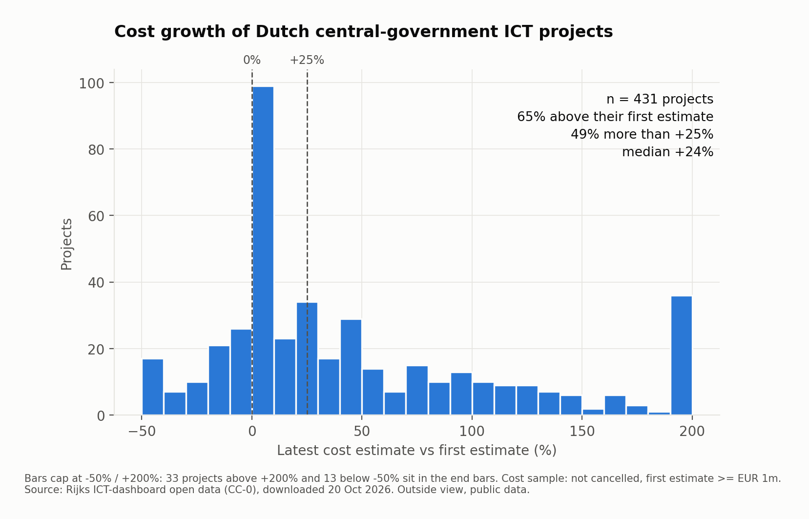
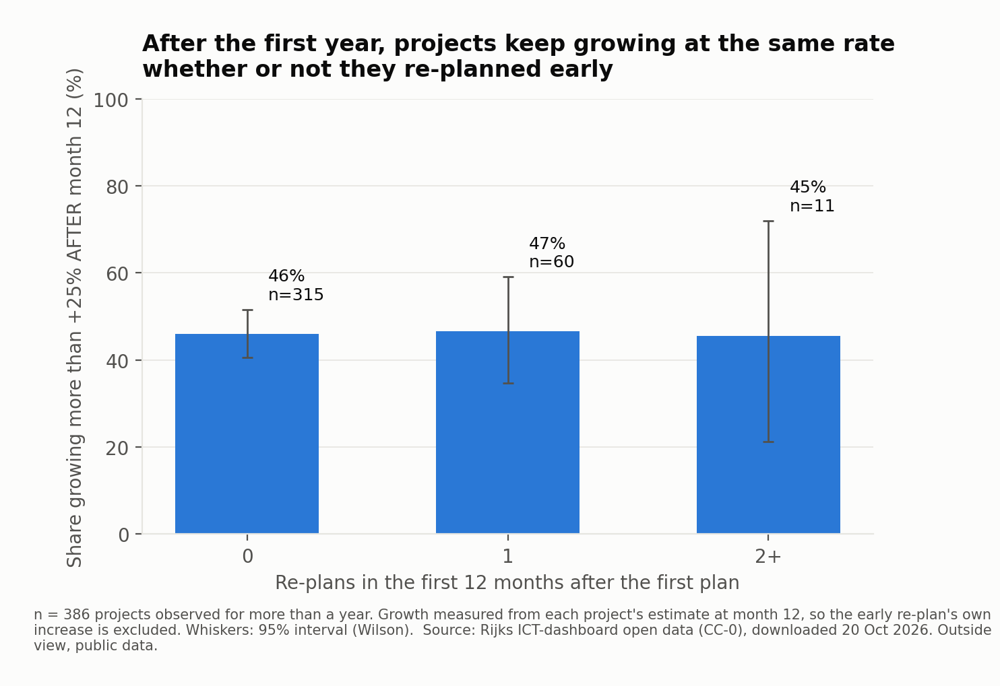
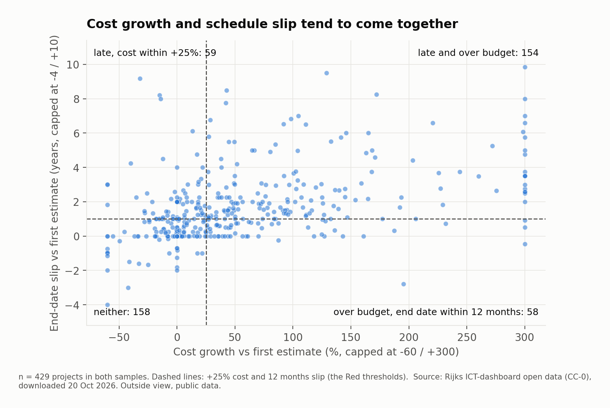

# Dutch government ICT portfolio health check

An outside-view health check of 516 large ICT projects run by Dutch central-government ministries, built from the government's own open data. It reads the portfolio the way a PMO (project management office) would: how far projects drift from their first plan, where the money goes, and which signals show up early enough to act on.

**Question:** How far do Dutch central-government ICT projects drift from their first cost and end-date estimates, and which signals visible early separate the big drifters from the rest?

**Finding:** 49.4% of 431 projects now sit more than 25% above their first cost estimate, and 47.9% of 472 expect to finish more than a year later than first planned. The drift keeps coming after year one: from the 12-month mark, about 46% still grow by more than 25%, whether or not they re-planned early.

**So what:** Across the 431 measurable projects, €11.7bn of first estimates has become €16.2bn: €4.5bn (+38.3%) more, of which one programme (ERTMS, rail signalling) accounts for €1.1bn. A quiet first year is no sign of health, so cost reviews need to run on a fixed cycle for a project's whole life, not only when it re-plans.



*49.4% of 431 projects sit more than 25% above their first cost estimate; the median project is +24.4%.*



*After month 12, about 46% of projects grow by more than another 25%, whether or not they re-planned in their first year.*



*154 of 429 projects are both more than 25% over budget and more than 12 months late; 158 are neither.*

The one-page PMO status report built from these numbers is in [`docs/PMO_status_report.md`](docs/PMO_status_report.md).

---

## Source

| | |
|---|---|
| Dataset | *Rijks ICT-dashboard* (central-government ICT dashboard), resource "Grote ICT-activiteiten Rijksoverheid" (large ICT activities of central government) |
| Listed at | <https://data.overheid.nl/dataset/rijks-ict-dashboard> |
| File | <https://rijksictdashboard.nl/api/opendata/json>, JSON, 7,513,246 bytes |
| Downloaded | 20 October 2026, 22:54 UTC |
| SHA-256 | `60e5495565b8ebc9c999fa2dc1f3987ea158d46f3ac6c1e0d9ecdc112f9aed07` (also in `data/raw/SHA256.txt`) |
| Licence | CC-0 1.0 |
| Publisher | *Ministerie van Binnenlandse Zaken en Koninkrijksrelaties* (Ministry of the Interior and Kingdom Relations) |
| Units | € millions. The dashboard's own cost charts are labelled "Miljoen (€)". |

The dataset page says "last modified 02-10-2023", but the file holds status dates up to 1 September 2026. The page metadata is stale; the dates used here come from the file itself.

Ministries report these projects themselves. Everything below is an outside view from that public data: no interviews, no internal documents, no insider knowledge.

### Dutch terms used in the data

| Dutch | English used here |
|---|---|
| *Initieel* | initial plan (the first estimate on record) |
| *Rapportage* | routine report |
| *Herijking* | re-plan (a formal reset of cost and/or end date) |
| *Reden herijking* | reason for the re-plan |
| *Actueel totaal projectkosten* | current estimate of total cost |
| *Daadwerkelijk totale projectenkosten* | actual spend to date |
| *Actueel geschatte einddatum* | current estimated end date |
| *Startdatum* / *Peildatum* | start date / status date |
| *Afgerond* / *In uitvoering* / *Geannuleerd* | completed / in progress / cancelled |
| *In heroriëntatie* / *Nog niet gestart* | under reorientation / not yet started |
| *Soort ICT-activiteit* | type of ICT activity |
| *Ontwikkelwijze* | development method (agile, waterfall, ...) |

---

## Method

```
data/raw/rijks_ict_opendata.json   official download, untouched
        │  src/load.py             parse, normalise, reconcile against the file, run integrity checks
        ▼
sql/ict.db                         SQLite: project, ministry, cost_report, replan_reason + lookup tables + views
        │  sql/queries.sql         Q1–Q13, each with a "how to explain" note
        ▼
results/query_results.txt          every number in this README (95% intervals: results/intervals.txt)
charts/*.png                       src/charts.py, from the same views
```

**Integrity.** `src/load.py` stops if any hard check fails: row counts and the summed estimates reconcile with the source file, foreign keys hold, every cost total equals the sum of its parts, all dates are valid, and reports are in date order. Known quirks in the source are counted, not hidden (`results/integrity_report.txt`). Two examples: one report carries cost components of −0.01m, a rounding artefact on a €0 entry, and one report is dated 1 January 2027, after the download (a not-yet-started project outside both samples).

**Definitions.** Each one changes the numbers, so each is stated:

- **First estimate (baseline):** the earliest report marked *Initieel* for the project.
- **Latest estimate:** the project's most recent report.
- **Cost growth:** (latest estimate − first estimate) ÷ first estimate.
- **Schedule slip:** latest estimated end date − first estimated end date.
- **Cost sample (431 projects):** not cancelled or not yet started, has an initial plan, first estimate at least €1m. Zero or near-zero baselines produce meaningless percentages.
- **Schedule sample (472 projects):** both end dates present and at least 90 days planned between start and first end date.
- **RAG status:** my convention, not an official standard. Red = cost growth above +25% or end date more than 12 months later. Amber = above +10% or more than 3 months later. Green otherwise. The thresholds live in `sql/views.sql`; change them and every RAG count moves.

How 516 projects become the two samples (Q1):

| Step | Projects |
|---|---:|
| Projects in the dataset | 516 |
| with an initial-plan report | 502 |
| and not cancelled or not yet started | 476 |
| **Cost sample:** and first estimate ≥ €1m | **431** |
| **Schedule sample:** both end dates, ≥ 90 days planned | **472** |

---

## Findings

Confidence labels: **high** = large sample, robust to the definitions above; **medium** = clear pattern, but small groups or an alternative explanation I could not rule out; **low** = suggestive only.

### 1. Half the portfolio sits more than 25% above its first cost estimate (high)

Of 431 projects, 282 (65.4%) have a latest estimate above their first one, 58.2% are more than 10% above, and 49.4% more than 25% above. The median project is +24.4%. 18.8% came in below their first estimate. (Q2, chart 1)

For completed projects the dashboard also reports actual spend. Measured on actual spend instead of the final estimate, the share above +25% falls from 51.0% to 46.9% (290 projects): 42 projects finished more than 5% under their final estimate. The direction does not change. (Q9)

### 2. The euros are concentrated (high)

The 431 first estimates add up to €11,725m; the latest estimates to €16,216m, an increase of €4,491m (+38.3%). The largest single increase, ERTMS (*European Rail Traffic Management System*), is €1,123m; without it the portfolio still added €3,368m. (Q2)

### 3. Most end dates move, typically by about a year (high, at year precision)

Of 472 projects, 72.2% now expect to finish later than first estimated, 67.4% more than 3 months later and 47.9% more than 12 months later. The median slip is 365 days, 37.1% of the planned duration. (Q3)

Read that median as "about a year". 45% of all estimated end dates in the data are 31 December (Q10), so many projects plan at year level and slip moves in year-sized steps.

### 4. Cost growth and schedule slip come together (high)

Of 429 projects in both samples, 154 are both more than 25% over and more than 12 months late, 158 are neither, and 117 have one problem without the other. (Q6, chart 5)

### 5. A first-year re-plan is not an early warning (medium)

Taken at face value, early re-plans look like a warning. 45.9% of projects with no re-plan in their first 12 months end up more than 25% above their first estimate, against 63.1% with one and 81.8% with two or more (Q5; the last group is 11 projects). That comparison is circular, though: a re-plan in year one already contains cost growth.

So I measured only the growth after month 12, starting from each project's estimate at that point (386 projects observed for more than a year). The early re-plan then makes no difference: 46.0% of projects with no first-year re-plan grew a further 25% or more, against 46.7% with one and 45.5% with two or more (Q11, chart 3). Within size bands the groups get small (down to 1–7 projects) and show no consistent direction.

The useful part is the other half of that result: from the 12-month mark, almost half the portfolio still grows by more than 25%. A quiet first year says little about how a project ends. Confidence is medium because the re-plan groups are small (60 and 11 projects).

Re-plans counted over the whole project life show an even steeper pattern (27.7% above +25% with no re-plans, 83.8% with four or more), but that is not an early warning: most of those re-plans are a response to growth that has already happened. (Q5)

Projects re-plan mostly for "setbacks within the project" (40.0% of re-plans with a stated reason) and "change of (business) goals or requirements" (29.8%). These reasons are self-reported. (Q8)

### 6. Small first estimates grow the most in percentage terms (medium)

| First estimate | Projects | Median cost growth | Share above +25% |
|---|---:|---:|---:|
| €1–5m | 64 | +94.3% | 84.4% |
| €5–20m | 230 | +23.3% | 47.8% |
| €20–100m | 124 | +5.0% | 35.5% |
| €100m+ | 13 | +13.3% | 38.5% |

(Q5 size_band, chart 2)

Two explanations fit and I cannot separate them with this data. The arithmetic one: a small base turns a modest euro increase into a large percentage. The selection one: small projects may reach a large-project dashboard precisely because they grew. In euros, the €100m+ band added the most (€1,550m from 13 projects).

### 7. Ministry and development method do not separate the drifters clearly (low)

By ministry (*ministerie*), the share above +25% runs from 26.3% (Health, Welfare and Sport, 19 projects) to 61.3% (Social Affairs and Employment, 75 projects). Of the nine ministries with at least 15 projects, only that extreme pair has 95% intervals that do not overlap, and only just (48.8% against 50.0%). With 36 possible pairs and only 19 projects at one end, I treat it as a question to check, not a ranking. By development method, waterfall shows 63.3% (30 projects, interval 45.5–78.1%) against 51.4% for agile/DevOps (140 projects, 43.2–59.6%): the intervals overlap, and 201 projects do not state a method. (Q5, chart 4; intervals in `results/intervals.txt`)

I would not rank ministries or methods on this data.

### At-risk projects

Still running, Red, ranked by euros added to the estimate (Q4). These are outside-view flags from public data, not a judgement on the teams.

| Project | Ministry | First est. €m | Latest est. €m | Growth €m | Growth % | Slip (days) | Re-plans |
|---|---|---:|---:|---:|---:|---:|---:|
| ERTMS | Infrastructure and Water Management | 2,400 | 3,523 | 1,123 | 47 | 730 | 0 |
| Programma iCAS | Infrastructure and Water Management | 152.6 | 355.3 | 202.7 | 133 | 2,011 | 0 |
| Maritiem Operatiecentrum Kustwacht (MOC KW) | Defence | 11.2 | 195.4 | 184.2 | 1,642 | 1,280 | 7 |
| Digitaal stelsel omgevingswet (DSO) | Housing and Spatial Planning | 104.1 | 238.2 | 134.1 | 129 | 3,472 | 4 |
| CHARM | Infrastructure and Water Management | 34.1 | 156.0 | 121.9 | 358 | 2,922 | 6 |
| LUV VTS | Infrastructure and Water Management | 13.0 | 116.0 | 103.0 | 792 | 3,598 | 6 |
| Bekostigen vernieuwt! | Education, Culture and Science | 23.9 | 105.3 | 81.5 | 342 | 2,556 | 3 |
| Moderniseren Examens | Education, Culture and Science | 26.8 | 71.8 | 45.1 | 168 | 1,827 | 1 |
| Generiek platform Document- en Archiefbeheer | Finance | 3.4 | 48.2 | 44.8 | 1,318 | 2,404 | 1 |
| Federatief Berichten Stelsel (FBS) | Interior and Kingdom Relations | 30.5 | 75.1 | 44.6 | 146 | 2,191 | 4 |

All ten have a status date of 31 December 2025 or later (Q4, status_date column).

### Portfolio status (Q7)

| Status | Red | Amber | Green |
|---|---:|---:|---:|
| Completed | 192 | 47 | 74 |
| In progress | 91 | 18 | 47 |
| Under reorientation | 2 | 1 | 2 |

---

## Limitations

- **Estimates, not outcomes.** Cost growth for running projects is growth so far; they can still grow. End dates are estimates throughout; the data holds no realised end date.
- **The first estimate is the dashboard's, not the business case's.** A project may have changed before it first reported. In 9 projects other reports even precede the *Initieel* entry.
- **Nominal euros.** First estimates span 2001–2026 (Q13) and are not adjusted for inflation; 36 re-plans cite price development as a reason (Q8).
- **Year-level end dates.** 45% of end dates are 31 December, so slip is precise to roughly a quarter or a year.
- **Recent projects are under-observed.** 14 projects in the cost sample had their first plan less than 12 months before the download (Q13), so their first-year re-plans are undercounted, and the youngest cohort (start 2021 or later) shows the least drift partly because it has had the least time.
- **Self-reported data.** Costs, dates and re-plan reasons come from the ministries themselves.
- **Associations, not causes.** Every grouping in this README looks at one property at a time unless stated otherwise.

---

## Explaining the numbers

| Number | From | How to explain it |
|---|---|---|
| 49.4% above +25% | Q2 | "For each project I divide the latest cost estimate by the first one. Half the portfolio is more than a quarter above where it started." |
| €4,491m / +38.3% | Q2 | "Sum of latest estimates minus sum of first estimates over the same 431 projects. One programme, ERTMS, is a quarter of it." |
| 47.9% more than 12 months late | Q3 | "Latest estimated end date minus the first one. I count against a year because most end dates are entered at year level." |
| 46.9% on actual spend | Q9 | "For finished projects I redid the check on what was actually spent, so nobody can say I picked the worse number." |
| about 46% grow > 25% after month 12 | Q11 | "I start the clock at month 12, so an early re-plan's own increase doesn't count. Projects that re-planned early and projects that didn't grow at the same rate afterwards: about 46% by more than a quarter." |
| 84.4% for €1–5m projects | Q5 | "Small first estimates grow most in percentage terms. Part of that is arithmetic; part may be that small projects only reach this dashboard after they grow." |

---

## Reproduce

Python 3.10+ with pandas and matplotlib (for the charts only; loading and queries use the standard library).

```bash
python3 -I src/load.py          # builds sql/ict.db, runs the integrity checks
python3 -I src/run_queries.py   # writes results/query_results.txt
python3 -I src/charts.py        # writes charts/*.png
```

```
data/raw/        official download + source record + checksum
sql/             schema.sql, views.sql (all definitions), integrity.sql, queries.sql, ict.db
src/             load.py, run_queries.py, charts.py
results/         integrity_report.txt, query_results.txt, intervals.txt
charts/          five PNGs
docs/            PMO_status_report.md
```
